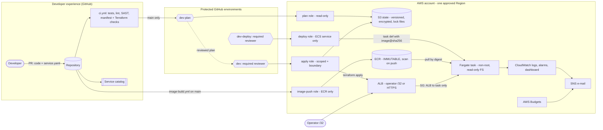
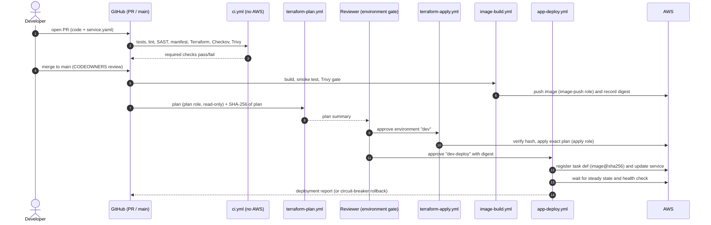

# Architecture

> Status legend used across all docs: 📋 **Planned** · 🛠️ **Implemented** (code exists) ·
> ✅ **Tested** (automated test passes offline) · ☁️ **AWS-verified** (observed in a real account, with evidence).
> As of Phase 1, **nothing is AWS-verified**: no AWS resources have been created.

## 1. Goal

A self-service Internal Developer Platform (IDP): a developer describes a service in a small,
validated manifest, opens a pull request, and the platform builds, scans, publishes and deploys it
to Amazon ECS Fargate through approval-gated pipelines. Developers never hold AWS credentials and
cannot express IAM, networking or arbitrary AWS resources.

## 2. Logical architecture

Source: [`diagrams/architecture.mmd`](../diagrams/architecture.mmd) (rendered by GitHub).

| Layer | Components | Status |
|---|---|---|
| Developer experience | Service manifest + JSON Schema + policy validator, generated service catalog, PR template, CODEOWNERS | 🛠️✅ (manifest, validator, catalog) · 📋 (repository template, deploy-request issue form: Phase 6) |
| Workload | FastAPI sample service, multi-stage non-root image | 🛠️✅ (offline + local container) |
| CI | `ci.yml` (pytest, Ruff, Bandit, manifest, catalog, Terraform fmt/validate/test/env data, TFLint, Checkov, Trivy, actionlint, zizmor, shellcheck) with a single `ci-ok` gate | 🛠️✅ Phase 2 |
| CD | `terraform-plan`, `terraform-apply`, `image-build`, `app-deploy`, `drift-detection`, `cleanup` | 📋 Phases 3–7 |
| Infrastructure | Terraform bootstrap, environment stack, 9 modules | 🛠️✅ interfaces + guardrail tests · 📋 resources (Phases 3–4) |
| Operations | Health checks, circuit breaker, alarms, rollback, drift detection | 🛠️ app health/readiness · 📋 the rest |

## 3. Environment strategy

| Environment | Purpose | Deployment policy | Status |
|---|---|---|---|
| `dev` | Integration and demos | Approved deploy from `main`; short-lived (deploy for a demo, then approved cleanup) | 🛠️✅ code ready ([dev-deployment-runbook.md](dev-deployment-runbook.md)) · ⏳ owner apply |
| `staging` | Release validation, rollback rehearsal | Manual approval | 🛠️✅ Terraform data validated only |
| `prod` | Production-style reference | Protected approval; HTTPS mandatory | 🛠️✅ Terraform data validated only |

**Account:** the AIOps project's AWS account, us-east-2, shared with that project's retained
bootstrap resources ([ADR 0005](adr/0005-shared-account-with-aiops-project.md)).

**Isolation in one AWS account (MVP):** separate Terraform state key and lock file per environment,
`<project>-<env>-` resource name prefixes, per-environment IAM roles whose OIDC trust names a
per-environment GitHub environment, environment tags, and separate security groups. Moving to an
account per environment later only changes `aws_account_id` and `backend.hcl` per environment.

**One stack, data per environment** ([ADR 0002](adr/0002-one-stack-per-environment-data.md)):
`terraform/stack` is the only root module; `terraform/envs/<env>/` holds just `terraform.tfvars`
and `backend.hcl`. Environments cannot drift structurally, because there is only one copy of the code.

## 4. Network design

### 4.1 Development MVP (cost-optimised) 📋

- VPC across **2 AZs** (an ALB requires two), public and private subnet definitions.
- **No NAT Gateway.** The single Fargate task runs in a **public subnet with a public IP** so it can
  pull from ECR and ship logs without NAT (which would add roughly $33/month plus data processing).
- Task security group: ingress **only from the ALB security group** on the container port. The
  public IP is not reachable from the internet.
- ALB security group: ingress **only from the operator's `/32`** when there is no TLS certificate
  (enforced by Terraform validation, ✅ tested). HTTPS with ACM is required for prod.

**Tradeoffs of public subnets and public IPs (documented exception):**

| Risk | Mitigation in MVP | Residual risk |
|---|---|---|
| Task has a public IPv4 address | SG allows inbound only from the ALB SG; no other inbound path | A security-group misconfiguration would expose the task directly. A Terraform test will assert the rule (Phase 4) |
| Unrestricted outbound internet from the task | Sample app needs no egress beyond AWS APIs | Data exfiltration possible if the app is compromised. Prod uses private subnets with controlled egress |
| Public IPv4 charges ($0.005/IP-hour) | 1 task, demos only | ~ $3.65/month per always-on task IP |
| HTTP without TLS in dev | `/32` ingress, no credentials or sensitive data over the endpoint | Traffic readable on path to the operator. Use HTTPS when a domain is available |

### 4.2 Production reference architecture 📋 (documented, not deployed)

- Tasks in **private subnets, no public IPs**, `desired_count >= 2` across 2–3 AZs (policy-enforced).
- Egress via **VPC endpoints** (ECR API, ECR DKR, S3 gateway, CloudWatch Logs, Secrets Manager, STS)
  or a NAT Gateway per AZ, plus an egress firewall if third-party egress is needed.
- **HTTPS only**: ACM certificate, TLS 1.3 policy, HTTP→HTTPS redirect, optional AWS WAF.
- ALB access logs to S3, deletion protection, Container Insights, longer log retention.
- Separate AWS accounts per environment under AWS Organizations with SCP guardrails.

## 5. Terraform module plan

| Module | Responsibility | Key guardrails (✅ = tested now) | Phase |
|---|---|---|---|
| `network` | VPC, 2–3 AZ public/private subnets, IGW, route tables, flow logs (boundary-carrying role), locked-down default SG | ✅ No NAT; subnets never auto-assign public IPs; private route table has no default route; default SG has no rules | 🛠️✅ Phase 4 |
| `load-balancer` | ALB, ALB SG, target group, HTTP/HTTPS listeners | ✅ Ingress must be `/32` without HTTPS (sensitive variable); HTTP→HTTPS redirect + TLS 1.3/1.2 policy with a certificate; egress only to the VPC; `drop_invalid_header_fields`, strictest desync mitigation | 🛠️✅ Phase 4 |
| `ecs-cluster` | Cluster, capacity providers | ✅ Fargate only; Container Insights off in dev (cost), on in prod | 🛠️✅ Phase 4 |
| `ecs-service` | Task definition, service, task SG, log group, execution + task roles | ✅ image **must** be `ECR@sha256:` digest; non-root, read-only root FS, all capabilities dropped (hard-coded); roles carry the boundary; execution role pulls only its repository; task role has no permissions; ingress only from the ALB SG; circuit breaker + rollback | 🛠️✅ Phase 4 |
| `ecr` | Repositories, lifecycle and repository policies | ✅ Tag immutability + scan on push hard-coded; KMS; keep ≥3 images; **only the image-push role can push** (repository policy) | 🛠️✅ Phase 3 |
| `iam-oidc` | plan / apply / deploy roles per environment + image-push role (the shared OIDC provider is looked up by the bootstrap) | ✅ Exact immutable `sub`, `aud` bound, **no `pull_request` trust**; plan role read-only except its `.tflock`; region-locked writes; boundary required for role creation; explicit deny on `aiops` resources, CI roles and audit settings | 🛠️✅ Phase 3 |
| `security` | Workload permissions boundary per environment (ECS execution/task roles live in `ecs-service`) | ✅ Denies `iam:*`, Organizations, billing, CloudTrail tampering; secrets limited to `idp/<env>/*` | 🛠️✅ Phase 3 |
| `observability` | SNS + e-mail, alarms (ALB/target 5xx, p95 latency, unhealthy/no healthy targets, CPU, memory), ECS deployment events → SNS + log group, dashboard | ✅ Service alarms only once a service exists; publish restricted to this account | 🛠️✅ Phase 4 |
| `budgets` | Monthly cost budget with actual and forecast alerts | ✅ Tag-filtered (`Project=idp`), 50/80/100% actual + 100% forecast | 🛠️✅ Phase 3 |

Root configurations:

| Root | Applied by | State | Contents |
|---|---|---|---|
| `terraform/bootstrap` 🛠️✅ | Administrator, once, from **AWS CloudShell** ([bootstrap-runbook.md](bootstrap-runbook.md)) | Local first, then migrated to the bucket it creates (`bootstrap/terraform.tfstate`) | State bucket, CloudTrail trail + bucket, CI roles (shared OIDC provider looked up), boundary, ECR, project budget: 28 resources |
| `terraform/stack` | `terraform-apply.yml` via the apply role, after approval | `envs/<env>/terraform.tfstate` + native lock file | Everything per environment |

Cross-cutting rules (implemented ✅ now): Terraform `>= 1.10` (native S3 locking), AWS provider
`~> 6.73` with a committed lock file, `allowed_account_ids` **and** a caller-identity postcondition,
approved-region list, `default_tags`, and no account IDs, e-mails or IPs in committed tfvars.

## 6. GitHub Actions workflow plan

| Workflow | Trigger | AWS role / GitHub environment | Behaviour | Safeguards |
|---|---|---|---|---|
| `ci.yml` 🛠️ | `pull_request`, `push` to `main` | **none** | pytest + coverage gate, Ruff, Bandit, manifest validation, catalog check, `terraform fmt/validate/test` + per-env data tests, TFLint, Checkov (IaC, Dockerfile, Actions, secrets), Trivy (repo + image), actionlint, zizmor, shellcheck; `ci-ok` aggregates them | `permissions: {}` + per-job read, SHA-pinned actions, `pipefail`, read-only provider lock files, no credentials, safe for fork PRs; rules enforced by `test_repo_hygiene.py` |
| `terraform-plan.yml` 🛠️ | `workflow_dispatch` (main) | plan role / `dev-plan` | account check, manifest rendered to tfvars, `plan -detailed-exitcode`, **plan digest** (SHA-256 over every planned change) + reviewable summary | **No plan artifact** (a plan file holds plaintext variables; public repo); sensitive IP/e-mail redacted; account ID masked; concurrency group shared with apply |
| `terraform-apply.yml` 🛠️ | `workflow_dispatch` (`plan_digest`, main) | apply role / `dev` (required reviewer, `main` only) | Re-plans with the same script, **refuses unless the digest equals the reviewed one**, applies that plan, publishes outputs | Fails closed (non-plan document, malformed digest, wrong account); any drift after review stops the apply; one plan/apply at a time |
| `image-build.yml` | `push` to `main` (app paths), `workflow_dispatch` | image-push role / (branch `main` subject) | Build, smoke test (read-only FS, UID check), Trivy HIGH/CRITICAL gate, push, record `image@sha256` + SBOM | No `latest` tag, immutable repo, push only after scan passes |
| `app-deploy.yml` | `workflow_dispatch` (service, env, digest) | deploy role / `dev-deploy` (required reviewer) | Render task definition from the validated manifest and digest, register it, update the service, wait for steady state, probe `/health`, write report | Digest must exist in ECR and have passed scan; circuit breaker rollback; never runs Terraform |
| `drift-detection.yml` | `schedule` (weekly), `workflow_dispatch` | plan role / `dev-plan` | `plan -detailed-exitcode`; exit 2 opens or updates an issue with the summary | **Never applies** |
| `cleanup.yml` | `workflow_dispatch` (typed confirmation) | plan role, then apply role / `dev` | `plan -destroy` of workload resources, reviewer approves, apply that plan, post-cleanup verification (no ALB / tasks / public IPs left) | Bootstrap (state, OIDC, ECR) excluded; protected approval |

**Deliberate improvements over the previous project** (which this design reviewed, not copied):

1. **No role trusts `pull_request`.** Previously, the plan role could be assumed from any same-repo
   PR branch. A PR could change the workflow file and read state through that role. Now PR CI is
   credential-free, and plans run from the `dev-plan` environment, which is limited to `main`.
2. **Plan integrity:** apply verifies a SHA-256 recorded at plan time (previously the artifact was
   trusted as downloaded).
3. **Digests, not tags:** deployments reference `image@sha256:…` (previously a mutable `image_tag` input).
4. **Separate deploy role:** day-to-day application releases do not need the infrastructure apply role.
5. **Stale approvals:** the previous project had an old apply re-run that waited in the queue for
   about 13 hours. Approval jobs get a `timeout-minutes`, and apply refuses plans older than the
   newest commit on `main`.

## 7. Key decisions

- [ADR 0001](adr/0001-ecs-fargate-over-eks.md): ECS Fargate rather than EKS for the MVP.
- [ADR 0002](adr/0002-one-stack-per-environment-data.md): one root stack, environments as data.
- [ADR 0003](adr/0003-no-oidc-trust-for-pull-requests.md): no AWS role is assumable from pull requests.
- [ADR 0004](adr/0004-static-generated-service-catalog.md): generated static catalog instead of a Backstage server.
- [ADR 0005](adr/0005-shared-account-with-aiops-project.md): reuse the AIOps account (us-east-2), keep all of its resources.
- [ADR 0006](adr/0006-python-3-13-standard.md): Python 3.13 is the standard; no automatic minor-version upgrades.
