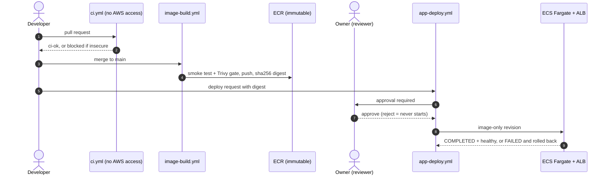

# Portfolio overview: Internal Developer Platform on AWS

*A 3-minute read. Every number below was measured or counted in this repository on 2026-11-23,
except where it says "estimate". Detailed proof with run IDs and timestamps:
[portfolio-evidence.md](portfolio-evidence.md).*

## The problem

Product teams want to ship services quickly. The platform team wants every release to be scanned,
approved, reversible and cheap, and nobody to hold AWS keys or write IAM policies. This project is
a self-service platform that gives both.

## What a developer does

1. `python scripts/new_service.py orders-api --owner team-payments --description "…"`. This creates
   a service from the golden-path template that passes CI with no edits.
2. They edit code and one validated `service.yaml`. It has no IAM, network or region fields, by design.
3. They open a pull request. CI runs tests and security scans, and an insecure change is blocked.
4. After the merge, the image is built, smoke-tested, scanned and published **by digest**.
5. They file a **Deploy request**. The owner approves, and the release rolls out with no downtime.

## What the platform guarantees (proven in AWS, not just designed)

| Guarantee | How | Evidence |
|---|---|---|
| No long-lived AWS keys anywhere | GitHub OIDC → 4 short-lived roles with exact subject trust (environment or `main`), permissions boundary | Phase 3 (28 bootstrap resources, verify 20/20) |
| Nothing reaches AWS without a human | Protected environments `dev`, `dev-deploy`; a **rejected** deploy never starts and gets no credentials | P5-A8 |
| Terraform applies exactly what was reviewed | SHA-256 digest of the plan; apply re-plans and refuses on any difference; the digest is bound to apply/destroy mode | 23 + 9 tests, mutation-tested; P4-A2, P5-A3 |
| Only scanned images run | Smoke test + Trivy gate before push; immutable tags; deploy by digest; only the pipeline role can push | P5-A1, P5-A7b; a vulnerable drill image was **blocked** (P7-A0) |
| A bad release heals itself | ECS circuit breaker; the deploy job verifies *that* rollout, not just "stable" | Drill: crash image → **FAILED and rolled back in ~5 min, app stayed up** (P7-A1) |
| Manual changes are caught, not silently fixed | Weekly read-only drift detection → GitHub issue | Drill: console edit → issue #15 → restored via reviewed apply → "No drift" (P7-A2) |
| Privacy in a public repository | Identifying values are secrets (masked); hygiene tests forbid IPs, account IDs and variables that would leak | Found and fixed a real leak in public logs (see below) |

**Measured in AWS (us-east-2):** dev infrastructure applied as 37 resources in about 3 minutes.
The first release was steady after 1 min 27 s. Approved releases completed in **150 s** and **146 s**
with 1 healthy target. The circuit-breaker rollback took about **5 min** (21:43 → 21:48 UTC).

## Engineering quality

- **Tests:** 241 platform tests (pytest), 27 service tests (100% coverage), and 65 Terraform test
  runs against a mocked AWS provider.
- **Mutation testing:** for each safety gate, I deliberately broke the code and confirmed a test
  fails. All mutations were caught.
- **Scanners in every PR:** Ruff, Bandit, Checkov (IaC, Dockerfile, Actions, secrets), TFLint,
  Trivy (repository + image), actionlint, zizmor and shellcheck. Every action is pinned to a commit
  SHA.
- **Decisions are written down:** 6 ADRs, a threat model (STRIDE), a security model with
  documented exceptions, a cost model, and runbooks for bootstrap, release, rollback, drift and
  cleanup.

## Real defects found, and how

Most of these were invisible to offline tests and only appeared because the work went to real AWS
and GitHub.

| Defect | How it surfaced | Fix |
|---|---|---|
| The plan-digest gate **failed open** on an empty plan document | A "drifted plan is refused" test passed when it should not have | Fail closed on non-plan documents; regression test |
| Operator IP and account ID **visible in public run logs** | Reading a plan log line by line | Moved to masked secrets, deleted 8 affected logs, hygiene test |
| Perpetual ECS task-definition **replacement** | First post-apply drift check | Write out ECS's normalised defaults; contract test |
| Image published as an **index with untagged children** (lifecycle risk) | Owner's ECR screenshot | Single-manifest build; push refuses indexes |
| Drill image with **fixable HIGH CVEs** | The Trivy gate blocked it, as designed | Same OS patching for every image; hygiene test |
| Console edit silently changed a **second alarm setting** | Drift drill plan | Restored by the reviewed apply (an argument for drift detection) |

## Cost

All figures are **estimates** from list prices. Offline development costs $0. Dev while running
costs about **$0.04/hour** (about $1/day), mostly ALB, public IPv4 and Fargate. There is no NAT
Gateway and no EKS. One reviewed workflow removes it (`cleanup.yml`). Budgets alert by e-mail.
See [cost-model.md](cost-model.md).

## Honest limits

- One environment (`dev`) is deployed. `staging`/`prod` are data files validated by tests and
  never applied.
- One service runs in AWS. A second service passes CI and joins the catalog, but deploying it needs
  platform work (its own ECR repository, a multi-service stack).
- The dev ALB is HTTP and limited to one /32 address (documented exception SE-2). HTTPS needs a
  domain and certificate.

## Where to look

| If you have… | Read |
|---|---|
| 1 minute | [README](../README.md) and the diagrams below |
| 10 minutes | [architecture.md](architecture.md), [security-model.md](security-model.md) |
| 30 minutes | [portfolio-evidence.md](portfolio-evidence.md): every claim with run IDs and timestamps |

Full diagrams: [diagrams/architecture.mmd](../diagrams/architecture.mmd) ·
[diagrams/delivery-flow.mmd](../diagrams/delivery-flow.mmd).
