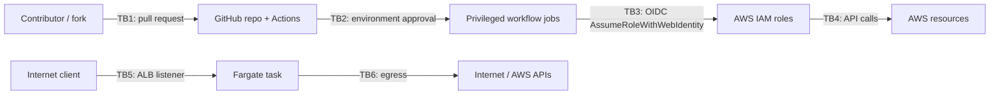

# Threat model

Method: STRIDE per trust boundary, scored Likelihood × Impact (1–3 each). Status legend:
📋 Planned · 🛠️ Implemented · ✅ Tested offline · ☁️ AWS-verified.

## 1. Assets

| Asset | Why it matters |
|---|---|
| AWS account (IAM, billing) | Full compromise = data loss, crypto-mining bills, pivot to the organization |
| Terraform state | Resource inventory; can contain sensitive attributes |
| CI role credentials (OIDC sessions) | Direct AWS access |
| Container images in ECR | Code that runs in AWS |
| Platform guardrails (schema, policy, workflows, CODEOWNERS) | If editable by anyone, every other control can be removed |
| Budget / cost | A portfolio account has a small budget; runaway resources are a real harm |

## 2. Trust boundaries

## 3. Threats and mitigations

| # | Boundary | STRIDE | Threat | L×I | Mitigation | Status |
|---|---|---|---|---|---|---|
| T1 | TB1 | E | PR modifies a workflow to assume an AWS role and read state or exfiltrate | 3×3 | No role trusts `pull_request`; PR CI has no credentials; roles trust environment subjects limited to `main` (ADR 0003) | 🛠️ design · 📋 Phase 3 trust policies |
| T2 | TB1 | T | Manifest requests IAM, public SGs, other regions or arbitrary resources | 3×3 | Schema has no such fields; `additionalProperties: false` | ✅ |
| T3 | TB1 | T | Manifest smuggles a value via duplicate YAML keys or YAML object tags | 2×3 | Duplicate-key loader; SafeLoader | ✅ |
| T4 | TB1 | I | Secret committed in a manifest env var | 2×3 | Name + value heuristics in policy; Trivy/Checkov secret scan; GitHub push protection | ✅ heuristics + scans · 📋 push protection |
| T5 | TB1 | T | Developer weakens guardrails by editing schema/policy in their PR | 2×3 | CODEOWNERS on `platform/`, `terraform/`, `.github/`; branch protection with code-owner review | 🛠️ CODEOWNERS · 📋 verify protection |
| T6 | TB2 | E | Approval bypass: environment exists but is not actually protected | 2×3 | Verify with the API (`GET /repos/{o}/{r}/environments`) that required reviewers and branch policies are set; record evidence | 📋 Phase 2 |
| T7 | TB2 | T | Reviewer approves plan A, apply runs plan B (or a re-plan) | 2×3 | Apply only consumes the artifact from the named plan run, verifies SHA-256 + commit SHA, never re-plans | 📋 Phase 3 |
| T8 | TB2 | T | Stale approval: an old queued apply runs after newer changes | 2×2 | `timeout-minutes` on approval jobs; apply refuses if `main` moved; concurrency group per env | 📋 Phase 3 |
| T9 | TB3 | S | Another repo/fork/branch obtains a token accepted by our roles | 2×3 | Exact `StringEquals` on `sub` and `aud`; no wildcards | 📋 Phase 3 (test asserts no `*` in subjects) |
| T10 | TB4 | E | Apply role creates an admin role and escalates | 2×3 | Boundary required on every created role; deny on removing boundaries and on CI-role edits | 📋 Phase 3 |
| T11 | TB4 | T | Pipeline targets the wrong account or region | 2×3 | `allowed_account_ids` + caller-identity postcondition; region allowlist + region postcondition; region-conditioned writes | ✅ (offline) |
| T12 | TB4 | D/$ | Runaway cost (forgotten resources, oversized tasks, NAT) | 3×2 | Policy size/count caps; no NAT; budget alerts; `cleanup.yml`; demo-only deploys | ✅ caps · 📋 budget/cleanup |
| T13 | TB4 | T | Mutable tag swapped to a malicious image after review | 2×3 | ECR `IMMUTABLE`; Terraform rejects non-digest images; deploy uses the digest recorded by the build | ✅ digest validation · 📋 ECR |
| T14 | TB4 | I | State/plan leakage | 2×2 | Encrypted, versioned, private state bucket with TLS-only policy; plan artifacts short-retention and sensitive | 📋 Phase 3 |
| T15 | TB5 | I | Plain-HTTP demo endpoint sniffed or abused | 2×1 | `/32` ingress without TLS (validation); no sensitive data; HTTPS for prod | ✅ |
| T16 | TB5 | I | Info disclosure via `/docs`, `/openapi.json`, `/metrics`, stack traces, `Server` header | 2×1 | Docs off outside `local`; metrics off by default; generic 500 body; `--no-server-header`; security headers | ✅ |
| T17 | TB5 | T | Header injection via `X-Request-ID` into logs | 2×1 | Strict pattern, otherwise replaced with a UUID; JSON-encoded logs | ✅ |
| T18 | TB5 | D | Metric-cardinality DoS by scanning random paths | 2×1 | Unmatched routes collapse into one `unmatched` series | ✅ |
| T19 | TB6 | I | Compromised task exfiltrates via unrestricted egress (public subnet) | 1×2 | Empty task role (nothing to steal from AWS); prod uses private subnets + endpoints | 🛠️ app needs no AWS · 📋 prod reference |
| T20 | Supply chain | T | Compromised base image, dependency or GitHub Action | 2×3 | Digest-pinned base, exact pins, Trivy gate, SHA-pinned actions, Dependabot PRs scanned before merge | 🛠️ partial · 📋 Phase 2 |
| T21 | Supply chain | T | Build "succeeds" while a security step silently did nothing | 2×2 | `pipefail` everywhere; `apt-get update --error-on=any` (real defect found in Phase 1) | ✅ (apt) · 📋 workflows |
| T23 | TB4 | T | Shared account: the AIOps apply role (or a compromised AIOps pipeline) modifies `idp` ECS/ELB/VPC resources; or `idp` cleanup deletes shared resources | 1×2 | `idp` never manages `aiops-*` or the OIDC provider (data lookup); `idp` apply role tag-conditioned + explicit deny on `aiops-*`; AIOps workflows are manual + approval-gated; drift detection reports unexpected changes (ADR 0005, SE-6) | 🛠️ design · 📋 Phase 3/7 |
| T22 | Repudiation | R | Cannot prove who approved or deployed what | 2×2 | GitHub environment approval logs, CloudTrail role sessions with OIDC subject, deployment report artifacts | 📋 Phase 5 |

## 4. Residual risks accepted for the MVP

- SE-1/SE-2 in [security-model.md](security-model.md#8-documented-security-exceptions) (public subnet, HTTP demo).
- Single maintainer: approvals are deliberate but not two-person (SE-5).
- Shared account with the AIOps project (T23, SE-6).
- Same-account environments: a bug in the apply role's scoping could affect another environment's
  resources. Name-prefix scoping and per-environment roles reduce the risk; separate accounts remove it (production reference).
